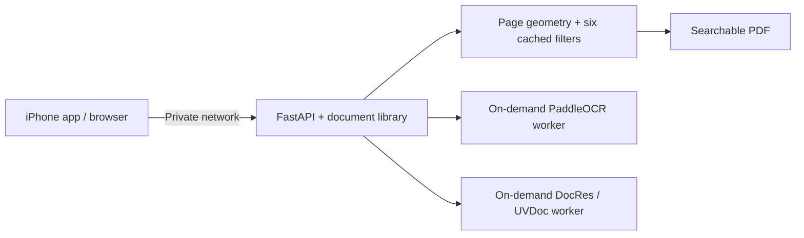

# TailScan

**A self-hosted document scanner for iPhone, with OCR and image processing on your own machine.**

[Tiếng Việt](README.vi.md) · [Self-hosting](docs/SELF_HOSTING.md) · [iPhone build](docs/IOS.md) · [Model credits](NOTICE.md)

TailScan combines an iOS client with a browser interface and a private Python API.
Connect your iPhone to your server through Tailscale, scan documents, and save a
searchable PDF. No Apple ID or signing certificate is needed in the build service;
you sign the unsigned IPA with your own sideloading tool.

## Features

- Capture or import up to 30 pages, reorder them, and export one PDF.
- Automatic corner suggestions, manual crop, rotation and optional UVDoc dewarping.
- Six filters: **DocRes**, **DocShadow**, white paper, color, original and black/white.
- Instant filter switching after preparation, using locally cached previews.
- PaddleOCR-VL-1.6 OCR, including Vietnamese and English, with searchable PDF text.
- A persistent document library with search, list/grid views, rename and editing.
- GPU workers load on demand and exit after five idle minutes. Reading the library,
  viewing cached filters and exporting a cached PDF do not wake the GPU.
- Native iPhone camera/photo permissions and system PDF sharing / Save to Files.



## Get started

1. Set up the Linux server using [SELF_HOSTING.md](docs/SELF_HOSTING.md).
2. Open its private URL in a browser, or install the unsigned IPA from
   [Releases](https://github.com/Soarr01/TailScan/releases).
3. On first launch, enter **your own server URL** in the iPhone app.
4. Scan, check the corners, choose a filter, and save your document.

The backend was tested on Linux with an NVIDIA RTX 2080 Ti (11 GB VRAM).
The iPhone client requires iOS 16 or newer. The iPhone does not run the OCR models;
your server must be available when processing new pages.
The current user interface is in Vietnamese.

## Repository layout

```text
server/              CPU API, document library, OCR worker and web UI
server/image_worker/ Isolated PyTorch image worker
ios/                 UIKit / WKWebView client and XcodeGen configuration
scripts/             Model downloads, validation and launch helpers
docs/                Deployment and build instructions
tests/               CPU-only regression checks
```

## Build and checks

GitHub Actions builds an unsigned IPA for a real iPhone and runs lightweight source
and backend checks. To run the source checks locally:

```bash
python -m compileall -q server scripts
node --check server/web/app.js
node --check server/web/library.js
node --check server/web/instant-filters.js
python scripts/audit_public.py
```

## Data and deployment model

The API assumes a trusted private network and shares one document library among
connected clients. This version has no user accounts or per-user authorization.
The launcher binds to loopback; use Tailscale Serve to reach it from your iPhone.

Saved library documents remain on the server until explicitly deleted. Temporary
jobs older than 24 hours are cleaned at server startup. Save important PDFs to
Files or another backup. OCR and geometric corrections can be imperfect; previews
let you compare the result with the original page.

## License

TailScan code is [MIT licensed](LICENSE). Pretrained models and downloaded upstream
source have their own licenses; see [NOTICE.md](NOTICE.md).
