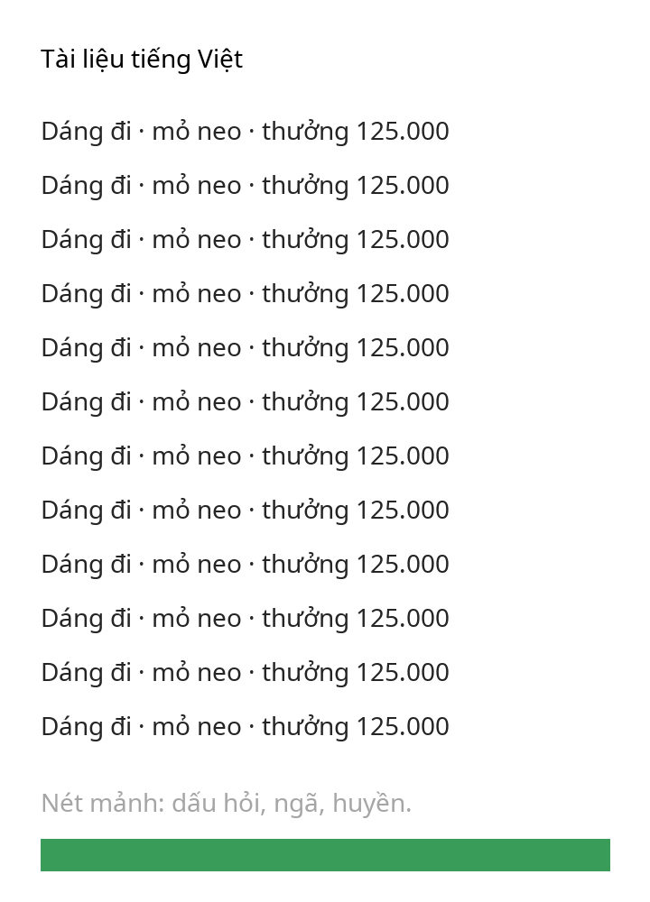
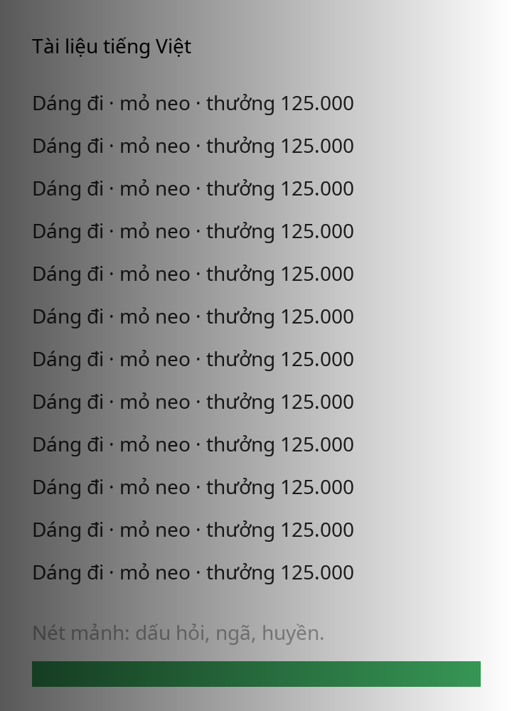
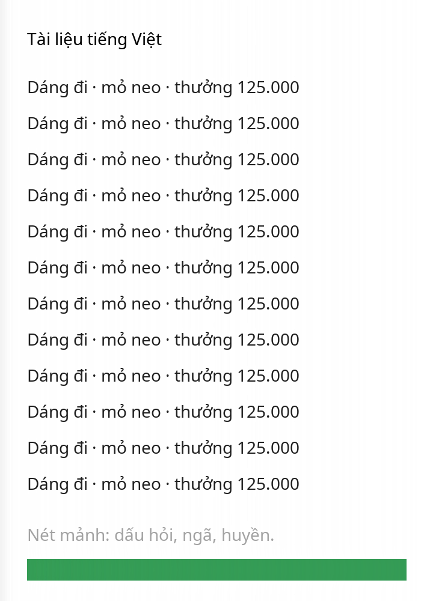
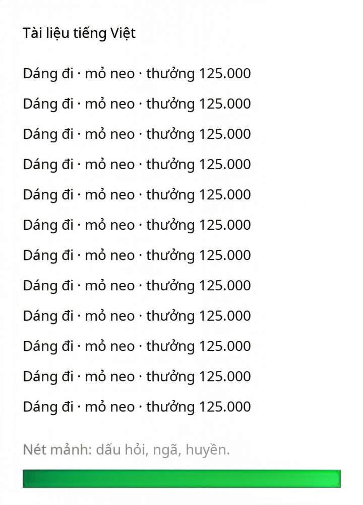
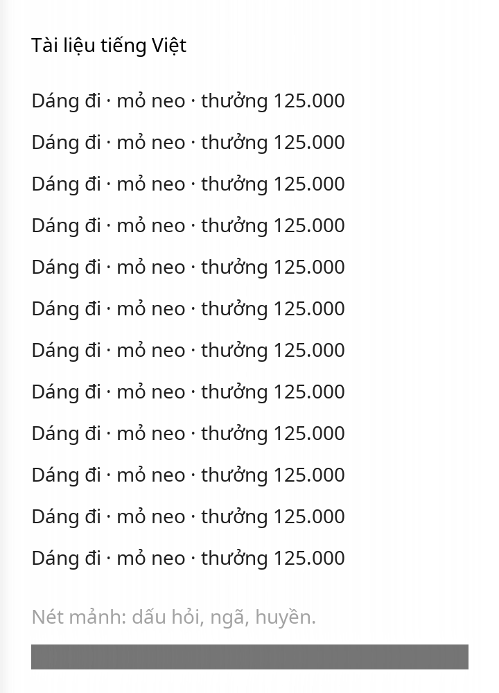

# Development model experiments

These are historical TailScan development measurements, collected for publication
on 2026-11-18. They are **small-sample observations, not a public leaderboard or a
claim of general SOTA accuracy**. The experiments use different inputs, precision,
hardware and preprocessing. Compare results only within the stated conditions.

Private document photographs, transcripts, prompts containing document content,
region coordinates, job IDs, hostnames and device UUIDs are not included. Numeric
summaries use anonymous document labels. Only procedurally generated example
images are published. Private-image CER results cannot be independently reproduced
without those withheld originals and references.

## 1. OCR: private document A

Six fixed readable blocks, 1,137 normalized reference characters. One block with
crossed-out text was excluded. Normalize with NFC and casefold; retain letters,
digits and Vietnamese accents, but discard punctuation and spacing. MonkeyOCR
recognizes supplied PaddleOCR regions; it is not a complete independently measured
layout pipeline. Chandra and Paddle use their document parsing outputs.

| Model | Character edits | CER % |
|---|---|---|
| PaddleOCR-VL-1.6 | 28 | 2.463 |
| MonkeyOCRv2-B-Parsing | 7 | 0.616 |
| Chandra-OCR-2 | 4 | 0.352 |

## 2. OCR: private document B

Seven fixed references, 1,075 normalized characters. Two other blocks containing
unit/formula formatting were excluded. SenOCR uses Chandra boxes with margins;
Qwen's region/focused variants also rely on supplied regions. Boxes can include
neighboring headings, so both strict and aligned scores are kept. Aligned scoring
matches the whole reference while allowing unrelated leading/trailing predicted
context; it still counts all internal errors and missing reference characters.

| Model/input | Strict edits | Aligned edits | Aligned CER % |
|---|---|---|---|
| Chandra-OCR-2 | 19 | 19 | 1.767 |
| SenOCR-Vi | 17 | 17 | 1.581 |
| Qwen3.5-9B-int8 | 101 | 7 | 0.651 |
| Qwen3.5-9B-int8 (full page) | — | 33 | 3.07 |
| Qwen3.5-9B-int8 (focused page) | — | 8 | 0.744 |

Timing context: the Qwen seven-region trial took 150.253 s excluding layout,
the full-page trial 177.681 s, and the focused-page trial 191.265 s. SenOCR's nine
region calls summed to about 29.94 s excluding layout. These are not comparable to
end-to-end document service times. Full per-case numeric logs are in
[ocr-runtime.csv](results/ocr-runtime.csv). Torch peaks are allocations, not total
VRAM or complete-system requirements.

**Deployment decision:** PaddleOCR-VL-1.6 was selected for the working native FP32
pipeline on the 11 GB RTX 2080 Ti. The lower CER of another model on a few supplied
regions does not establish that it is the better complete scanner. Chandra, Qwen,
SenOCR and the BF16 MonkeyOCR trial were measured on a separate RTX 3080 20 GB.

## 3. Automatic corner detection

Twelve generated cases from one page (seed 2411), including perspective, lighting,
blur and partial occlusion. The initial incorrect-preprocessing experiment is
excluded. FastViT did best on these generated inputs; DocQuadNet was selected after
checking the private photographs and retaining editable suggestions / border
protection. No private corner coordinates are published.

| Method | Mean IoU | Detected / cases |
|---|---|---|
| classic | 0.3277 | 4 / 12 |
| docaligner-lcnet | 0.5670 | 7 / 12 |
| docaligner-fastvit | 0.9689 | 12 / 12 |
| docquadnet256 | 0.9564 | 12 / 12 |
| docquadnet256-safe | 0.9564 | 12 / 12 |

## 4. Appearance restoration

Three lighting variants of **one** generated document, not three independent pages.
The synthetic lighting is multiplicative and therefore favors background-division
methods. Color PSNR also penalizes grayscale conversion, so these numbers should
not be read as perceptual rankings or OCR accuracy. DocRes used FP16, 512-square
neural inference and an original-resolution gain field on an RTX 2080 Ti.

| Method | Synthetic cases | Mean PSNR dB | Mean SSIM |
|---|---|---|---|
| legacy_clean | 3 | 25.663 | 0.99044 |
| paper_color | 3 | 43.789 | 0.99675 |
| paper_gray | 3 | 29.954 | 0.99357 |
| docres_appearance | 3 | 29.461 | 0.98241 |
| docres_deshadow | 3 | 25.138 | 0.98650 |
| docres_lightfield | 3 | 28.676 | 0.97765 |

Frozen example from synthetic case 0; these are actual experiment outputs:

| Clean target | Shadowed input |
| --- | --- |
|  |  |

| Color correction | DocRes appearance | Grayscale correction |
| --- | --- | --- |
|  |  |  |

Only case 0 images are included as illustrations; the numeric files retain all
three conditions. No private before/after photographs are published.

## 5. Effect of display filters on a fixed OCR model

Two fixed private crops, 2,212 reference characters. The same PaddleOCR-VL-1.6 and
alignment were applied to each filtered input. This is an experiment; production
OCR reads the **unfiltered corrected geometry**, before the display filter.

| Input to OCR | Character edits / reference characters |
|---|---|
| input | 47 / 2212 |
| legacy_clean | 48 / 2212 |
| paper_gray | 49 / 2212 |
| docres_appearance | 45 / 2212 |
| PhaSR-Ambient6K-lightfield | 47 / 2212 |

The small differences (45–49 edits) do not establish a general accuracy winner.
Per-photo rows and elapsed OCR times are preserved in [filter-ocr.csv](results/filter-ocr.csv).

## 6. PhaSR and DocShadow

- **PhaSR Ambient6K / ISTD+:** RTX 3080 20 GB, max edge 512, FP16 autocast adaptation
  rather than the official script's BF16, no TTA. DepthAnythingV2-L is computed in
  a separate stage before the DINOv2-L restoration stage. Per-shape restoration,
  depth times and Torch allocations are retained in [phasr.csv](results/phasr.csv).
  Cold/first-shape calls differ from warm calls; this was not run on the 2080 Ti.
- **DocShadow SD7K:** CPUExecutionProvider, FP32 512×512, four threads. The two
  measured calls were about 0.82–0.86 s, excluding session/model load. A smoothed
  gain field is applied to original pixels; this adaptation is not an official
  paper benchmark output. OCR accuracy was not measured for the new candidate.
  It is available as an optional filter; DocRes remains the default.

## 7. Curved-page dewarping

UVDoc and DocRes+MBD were tested on two full photos and the corresponding crops.
UVDoc's four measured calls took roughly 0.07–0.31 s, with no folded sampled cells.
DocRes+MBD produced folds and visible edge artifacts on the cropped inputs and was
not enabled. The tested grids differ (45×31 vs 256×256 after smoothing) and the GPUs
differ, so neither fold percentages nor timings are direct model rankings.

On a separate same-crop OCR check, flattening gave 21 character edits versus 20
without it, over 1,075 reference characters. It improved the apparent geometry in
that photo but did not demonstrate improved OCR accuracy.

## 8. Runtime behavior, not model accuracy

GPU idle sleep was checked using the actual 300-second setting while health was
polled. Total device VRAM fell from 4,742 to 135 MiB; worker exits were observed at
306.6 seconds idle with five-second sampling. Cached filter/PDF operations did not
wake workers. Cold-start OCR and six-filter switching were tested separately.
Desktop browser handler times of a few milliseconds are **not iPhone frame-time
measurements**. An initial repeated-wake stall led to initializing and predicting
on one OCR executor and adding a bounded worker timeout; subsequent cold cycles
passed. This is operational validation rather than a model benchmark.

## Files and provenance

Each result group has JSON metadata and a CSV table in [results/](results/).
All raw OCR text, reference text and private file metadata were removed through
field allowlisting rather than publishing the original logs. Synthetic images
were exported by explicit filenames from the generator outputs.

See [METHODS.md](METHODS.md) for scoring definitions and limitations, and
[model credits](../NOTICE.md) for upstream projects. Model weights are not included.
